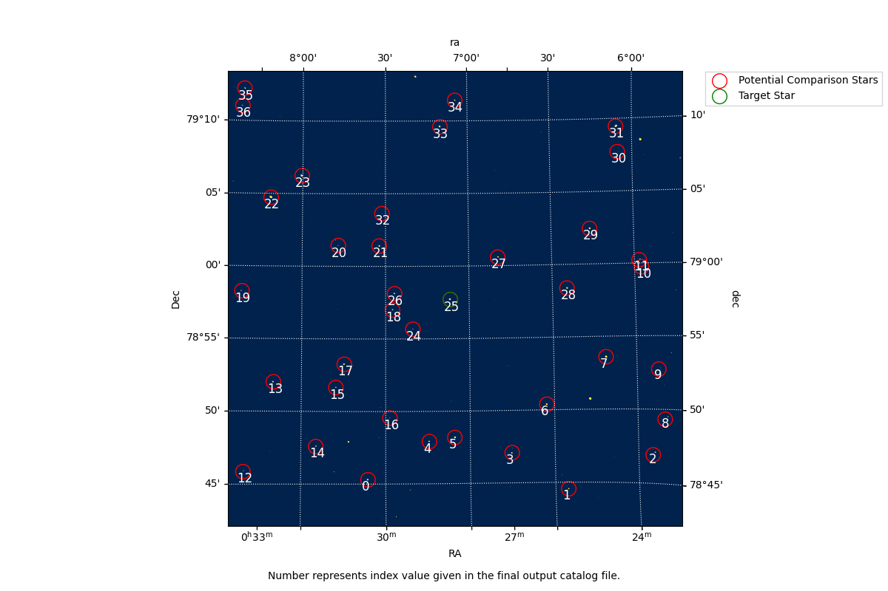
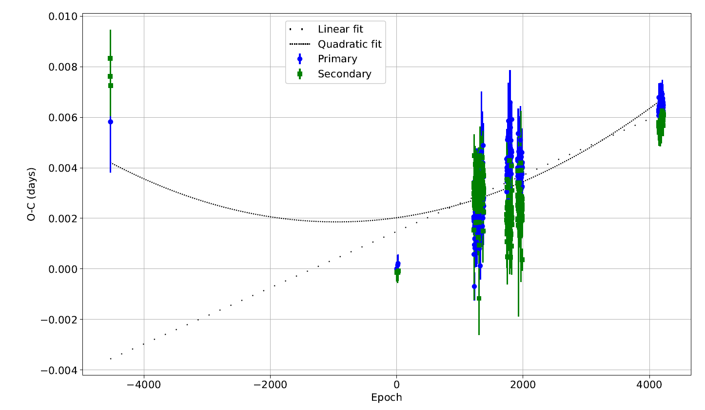
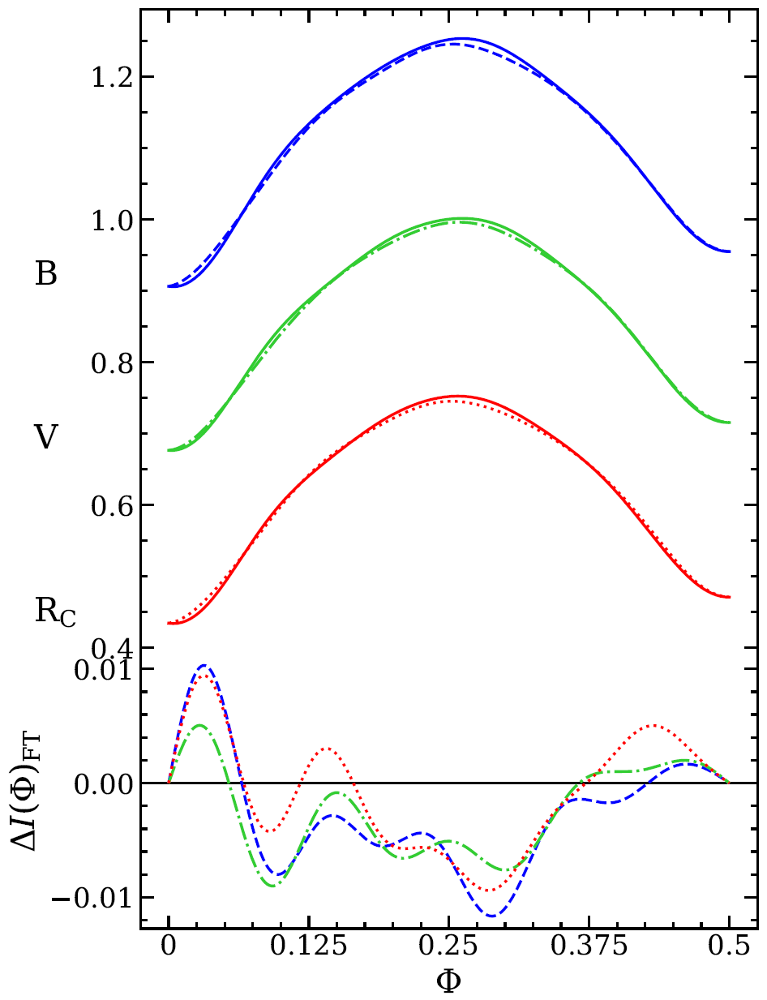
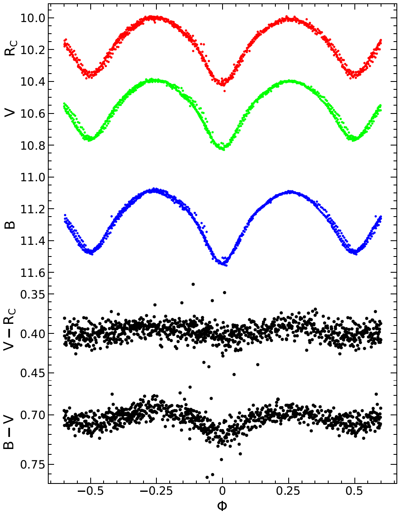
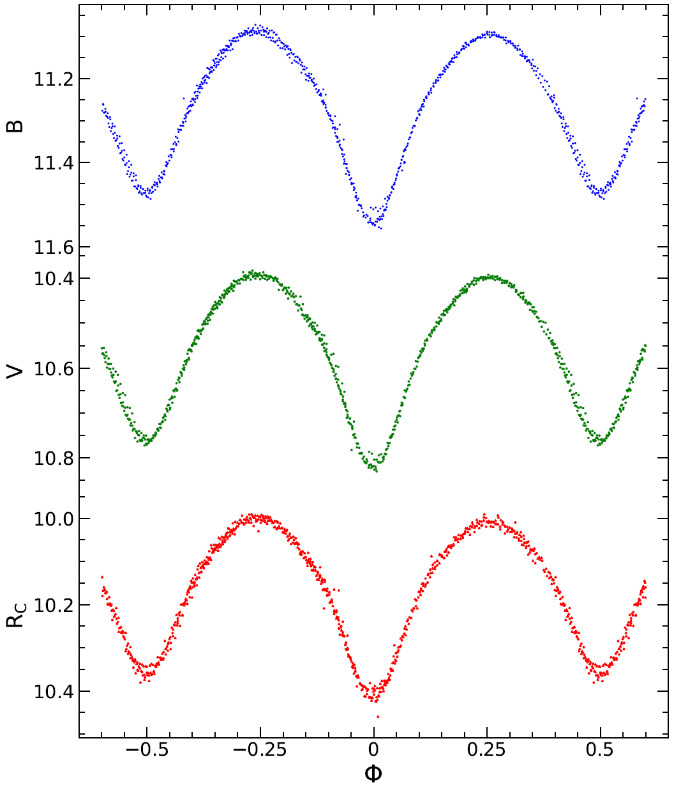

.. _toolbox:

Program Options
===============

.. Important::
    This documentation is not meant to go over all the physics/astronomy or background
    knowledge required to fully understand what the various programs are doing.

Menu
----

After launching EclipsingBinaries as described in :ref:`EB`,
the user is presented with a GUI that centralizes all available tools. The sidebar on the
left lists the programs, grouped in the order they're usually used, and the right side
displays the inputs and output log for the selected program.

The sidebar lists:

+ **Reduce** — IRAF Reduction
+ **Comparison stars** — AIJ Comparison Star Selector
+ **Photometry** — Multi-Aperture Photometry, Night Filters
+ **Analysis** — Period Search, Find Minimum, O-C Plotting, O'Connell Effect, Color Light Curve
+ **Archives** — TESS Search and Download, Gaia Search

To quit, use **File > Exit** (or the application menu on macOS).

When a program finishes, buttons for its output appear next to **Run**:

IRAF Reduction
--------------

Making heavy use of `Astropy's ccdproc <https://ccdproc.readthedocs.io/en/stable/ccddata.html>`_,
this program provides an automatic data reduction process using Bias, Dark, and Flat frames
to reduce science images.

The GUI panel accepts the following inputs:

+ **Raw Images Path** — folder containing the raw, unreduced FITS images
+ **Calibrated Images Path** — folder where reduced images will be saved (created if missing)
+ **Location** — telescope site. Leave it empty for BSUO. See `Camera Presets`_ below.
+ **Use Dark Frames** — checkbox to include or skip dark frame subtraction
+ **Overscan Region** — format ``[columns, rows]``. Leave it empty for the BSUO default
  ``[2073:2115, :]``, or enter ``none`` to skip overscan subtraction.
+ **Trim Region** — format ``[columns, rows]``. Leave it empty for the BSUO default
  ``[20:2060, 12:2057]``.

The **Open Bias Image** button plots the counts along the middle row of a selected bias
frame in its own window, with the matplotlib toolbar for zooming. Use it to find where the
overscan begins before running the reduction. The dashed "suggested start of overscan" line
is drawn at column 2077, the BSUO camera value, and only when the image is wide enough.

.. note::
    For ``ccdproc``, if the same rows are entered for both the overscan and trim region,
    ``ccdproc`` will error out. The recommendation is to use all rows (``:``) for the
    overscan region and specify exact rows only for the trim region.

Each run writes ``reduction_config.json`` (the settings used) and ``reduction_summary.txt``
(per-stage counts and any per-frame failures) to the calibrated images folder.

Camera Presets
^^^^^^^^^^^^^^

The **Location** value picks the camera gain and read noise used for the reduction:

=============  =============  ===============
Location       Gain (e⁻/ADU)  Read noise (e⁻)
=============  =============  ===============
``BSUO``       1.43           10.83
``KPNO``       2.3            6.0
``CTIO``       2.0            9.7
``LaPalma``    1.0            6.3
=============  =============  ===============

Case and spaces are ignored, so ``La Palma`` and ``kpno`` work too. Any other site name
uses the BSUO camera values. From Python, ``site_config`` builds the same settings and
accepts overrides for any ``ReductionConfig`` field:

.. code-block:: python

    from EclipsingBinaries.IRAF_Reduction import run_reduction, site_config

    cfg = site_config("KPNO", rdnoise=5.5, dark_bool=False)
    run_reduction("raw_images", "calibrated_images", cfg=cfg)

The memory limit for combining frames defaults to 1.6 GB in ``ReductionConfig``
(``mem_limit``). The ``EB_pipeline`` command uses 450 MB unless ``--mem`` is given.

Reduction Functions
^^^^^^^^^^^^^^^^^^^

The main reduction stages are ``bias``, ``dark``, ``flat``, and ``science_images``. Every
frame first goes through the same preprocessing step: overscan subtraction (unless the
overscan region is ``none``), trimming, then conversion to electrons using the gain:

.. literalinclude:: ../EclipsingBinaries/IRAF_Reduction.py
   :pyobject: _preprocess

Bias
^^^^

The bias reduction subtracts the overscan and trims each raw bias frame, then
combines them into a master bias using sigma clipping:

.. literalinclude:: ../EclipsingBinaries/IRAF_Reduction.py
   :pyobject: bias

The ``sigma_clip_dev_func`` computes the standard deviation about the central value.
See `ccdproc documentation <https://ccdproc.readthedocs.io/en/stable/api/ccdproc.Combiner.html#ccdproc.Combiner.sigma_clipping>`_
for more details.

Dark
^^^^

Once the master bias is created, dark frames are bias-subtracted and combined into
a master dark. Dark subtraction can be skipped entirely using the **Use Dark Frames**
checkbox, since modern cooled CCDs often have negligible thermal noise.

.. literalinclude:: ../EclipsingBinaries/IRAF_Reduction.py
   :pyobject: dark

Flat
^^^^

The master bias and master dark are subtracted from each flat frame. Master flats
are created per filter:

.. literalinclude:: ../EclipsingBinaries/IRAF_Reduction.py
   :pyobject: flat

Science
^^^^^^^

Science images are bias-subtracted, dark-subtracted, and flat-divided using the
master flat for the matching filter:

.. literalinclude:: ../EclipsingBinaries/IRAF_Reduction.py
   :pyobject: _reduce_science

``science_images`` runs that step over every ``LIGHT`` frame and records any frames that
fail without stopping the rest:

.. literalinclude:: ../EclipsingBinaries/IRAF_Reduction.py
   :pyobject: science_images

Adding to the Header
^^^^^^^^^^^^^^^^^^^^

Each reduced image has the reduction parameters written to its FITS header by the
``add_header`` function:

.. literalinclude:: ../EclipsingBinaries/IRAF_Reduction.py
   :pyobject: add_header

Header Correction
^^^^^^^^^^^^^^^^^

`TESS <https://tess.mit.edu/>`_ uses ``BJD_TDB`` while BSUO and
`SARA <https://www.saraobservatory.org/>`_ use ``HJD``. After each science frame is
calibrated, the time and position keywords are corrected so every telescope and satellite
ends up on the same standards. This is a refactor of Robert Berrington's (BSU)
``header-correct.py`` script and writes:

+ ``JD_START``, ``JD_MID``, ``JD_END`` and ``JD``
+ ``HJD`` and ``HJD_UTC`` at mid-exposure
+ ``BJD_UTC`` and ``BJD_TDB`` at mid-exposure
+ Mean and apparent sidereal time
+ ``SECZ`` and ``EAIRMASS`` (IRAF's effective airmass formula)
+ RA/DEC rewritten in IRAF sexagesimal format

Each correction can be turned off with the ``correct_*`` fields of ``ReductionConfig``
(``correct_jd``, ``correct_hjd``, ``correct_bjd``, ``correct_sidereal``,
``correct_eairmass``, ``correct_filter_spaces``), or all at once with
``correct_headers=False``. The BJD calculation:

.. literalinclude:: ../EclipsingBinaries/headerCorrect.py
   :pyobject: _write_bjd

The observatory is read from the ``OBSERVAT`` header keyword. These sites are built in and
need no internet connection:

+ ``BSUO``, ``BSU`` and ``SFRO`` — coordinates from the BSU Cooper Science Observatory record
+ ``KPNO``, ``CTIO`` and ``LAPALMA``, plus the SARA sites that map to them (``SARA-KP``,
  ``SARA-N``, ``SARA-CT``, ``SARA-S``, ``SARA-RM``) — coordinates copied from
  `astropy's site registry <https://github.com/astropy/astropy-data/blob/gh-pages/coordinates/sites.json>`_

If ``OBSERVAT`` is missing or names a site that isn't known, the reduction falls back to
the **Location** setting and notes it in the log. Calling ``correct_headers`` directly falls
back to ``BSU`` instead. To add your own site:

.. code-block:: python

    from EclipsingBinaries.headerCorrect import ObservatoryRegistry, ObservatorySite, correct_headers

    registry = ObservatoryRegistry()
    registry.register(ObservatorySite(name="MYOBS", lat="41:30:00", lon="-87:00:00", altitude_m=200.0))
    correct_headers("image.fits", registry=registry)

``correct_headers_batch`` does the same for a list of files.

Correcting Headers from the Command Line
^^^^^^^^^^^^^^^^^^^^^^^^^^^^^^^^^^^^^^^^

``EB_HCorr`` runs the same corrections on images outside a reduction, changing the files
in place::

    EB_HCorr raw_images/                      # every .fits, .fit and .fts file in the folder
    EB_HCorr -r data/                         # and in the folders inside it
    EB_HCorr image1.fits image2.fits --observatory SARA-KP

Each correction can be turned off with ``--no-jd``, ``--no-hjd``, ``--no-bjd``,
``--no-sidereal``, ``--no-eairmass`` or ``--no-radec-format``, and ``--filter-parse``
replaces spaces in ``FILTER`` with underscores. ``--observatory`` sets the site used when
``OBSERVAT`` is missing or unknown (``BSU`` unless given). ``-q`` prints only warnings and
the summary. ``EB_HCorr -h`` lists everything.

It prints how many keywords each file got, any warnings, and a summary, and exits with
``0`` when every file was corrected without warnings, ``1`` when any had warnings, and
``2`` for bad arguments.

Some cameras need care, and the corrections handle these:

+ ``DATE-OBS`` holding only the date, with the time in ``TIME-OBS``, ``UT`` or ``UTSTART``,
  is joined into one time. Without any of those the exposure is taken to start at midnight
  UT, with a warning.
+ The coordinate frame comes from ``EQUINOX``, written as 2000, ``J2000`` or ``J2000.0``.
  (Earlier versions skipped HJD and BJD when ``EPOCH`` held the observation date.)
+ Running it twice keeps the camera's original ``SECZ`` in ``SECZ_ORG``.
+ If the target comes out below the horizon, ``SECZ`` and ``EAIRMASS`` are left alone and
  a warning suggests checking ``OBSERVAT``, ``DATE-OBS`` and RA/DEC.

TESS Search and Download
-------------------------

TESS is a valuable resource for eclipsing binary research — if a target is in the
database it typically has weeks to months of continuous photometry available.

The GUI panel accepts the following inputs:

+ **System Name** — the TIC ID or common name of the target (e.g. ``NSVS 896797``)
+ **Download Path** — folder where sector data will be saved
+ **Download Specific Sector** — checkbox to select a single sector instead of all available sectors

When **Download Specific Sector** is checked, a **Retrieve Sectors** button appears.
Clicking it queries TESS for available sectors and populates a dropdown for the user
to select from. The sector table is also printed to the output log.

If the search or a download fails, the error is shown in the log and the task ends with an
error rather than a success message.

From Python, ``run_tess_search(system_name, single_sector, specific_sector, download_path)``
downloads every sector when ``single_sector`` is ``False``, or only ``specific_sector``
when it is ``True``. That argument used to be called ``download_all``, although ``True``
always meant a single sector.

Searching TESS
^^^^^^^^^^^^^^

Given an object name, the program queries TESS for available sector numbers:

.. literalinclude:: ../EclipsingBinaries/tess_data_search.py
   :pyobject: run_tess_search

Downloading
^^^^^^^^^^^

Sectors are downloaded as ``30x30 arcmin`` cutouts — the maximum size allowed by TESS.
Each sector is saved to its own numbered subdirectory inside the download path:

.. literalinclude:: ../EclipsingBinaries/tess_data_search.py
   :pyobject: download_sector

TESSCut
^^^^^^^

The downloaded TESS file is a FITS file containing all images for a given sector.
The ``tesscut.py`` file handles extracting individual images and reading the mid-exposure
time in ``BJD_TDB`` from each image's metadata:

.. literalinclude:: ../EclipsingBinaries/tesscut.py
   :pyobject: process_tess_cutout

BJD to HJD
^^^^^^^^^^

.. literalinclude:: ../EclipsingBinaries/tesscut.py
   :pyobject: bary_to_helio

Takes ``RA``, ``DEC``, ``BJD_TDB``, and an astropy site name as inputs and returns the
light-travel-time corrected ``HJD``. TESS cutouts use ``greenwich``, which ships with
astropy, so no download is needed.

AIJ Comparison Star Selector
-----------------------------

Catalog Search
^^^^^^^^^^^^^^

The GUI panel accepts the following inputs:

+ **Right Ascension (RA)** — format ``HH:MM:SS.SSSS``
+ **Declination (DEC)** — format ``DD:MM:SS.SSSS`` or ``-DD:MM:SS.SSSS``
+ **Data Save Folder Path** — where RADEC files will be written
+ **Object Name** — used for output file naming
+ **Science Image File** — a calibrated science image for the overlay plot. A folder also
  works, in which case the first FITS file in it is used.

The program queries the `Vizier APASS catalog <https://vizier.cds.unistra.fr/viz-bin/VizieR-3?-source=II/336/apass9>`_
using a 30 arcmin search box centered on the target:

.. literalinclude:: ../EclipsingBinaries/apass.py
   :pyobject: comparison_selector

Only stars with Johnson B and V magnitudes below 14 are returned.

Cousins R
^^^^^^^^^

The Cousins R magnitude for each comparison star is calculated using the equation
from `Jester et al. 2005 <https://arxiv.org/pdf/astro-ph/0609736.pdf>`_:

.. literalinclude:: ../EclipsingBinaries/apass.py
   :pyobject: calculations

.. literalinclude:: ../EclipsingBinaries/examples/APASS_Catalog_ex.txt
    :language: text
    :lines: 1-10

Gaia
^^^^

The comparison star selection also queries the
`Gaia DR3 <https://www.cosmos.esa.int/web/gaia/data-release-3>`_ catalog to calculate
TESS magnitudes for each comparison star. References:

+ https://iopscience.iop.org/article/10.3847/1538-3881/acaaa7/pdf
+ https://iopscience.iop.org/article/10.3847/1538-3881/ab3467/pdf
+ https://arxiv.org/pdf/2012.01916.pdf
+ https://arxiv.org/pdf/2301.03704

.. literalinclude:: ../EclipsingBinaries/gaia.py
   :pyobject: tess_mag

If the TESS magnitude for a comparison star cannot be determined, its value and error
are set to ``99.999`` so it will not be selected as a comparison star.

Creating RADEC Files
^^^^^^^^^^^^^^^^^^^^

Four RADEC files are created — one each for Johnson B, Johnson V, Cousins R, and TESS —
using Astro ImageJ (AIJ) formatting:

.. literalinclude:: ../EclipsingBinaries/apass.py
   :pyobject: create_radec

Overlay
^^^^^^^

An optional overlay plot shows the locations of all comparison stars on a science image,
with circles and index numbers marking each star:

.. literalinclude:: ../EclipsingBinaries/apass.py
   :pyobject: overlay

Multi-Aperture Photometry
-------------------------

Runs aperture photometry on reduced science images for Johnson B, V and Cousins R, using
the target and comparison stars from the RADEC files made by the
`AIJ Comparison Star Selector`_. It uses `Photutils <https://photutils.readthedocs.io/en/stable/aperture.html>`_
apertures and annuli, and the target magnitude is calibrated against the ensemble of
comparison stars.

The GUI panel accepts the following inputs:

+ **Object Name** — used for output file naming
+ **Reduced Images Path** — folder of calibrated ``LIGHT`` frames
+ **Number of Filters** — radio buttons for 1, 2 or 3 filters, the same as in the
  O'Connell Effect panel. That many RADEC rows are shown.
+ **RADEC File** — one row per filter, each with a dropdown to pick which filter it is
  (B, V or R) and that filter's RADEC file. The first row of a RADEC file is the target
  and the rest are comparison stars. The dropdowns start at V for one filter, B and V for
  two, and B, V and R for three; once you pick a filter yourself, changing the number of
  filters keeps your choice. Each filter can only be picked once.
+ **Aperture Radius**, **Inner Annulus Radius**, **Outer Annulus Radius** — in pixels.
  Leave them empty for 20, 30 and 50.

Images are grouped by the ``FILTER`` keyword. ``Empty/B`` and ``B`` style names work out
of the box; other names need a ``filter_config.json`` as described in
:ref:`custom-filter-mapping`.

Shared Comparison Stars
^^^^^^^^^^^^^^^^^^^^^^^

B, V and R always use exactly the same comparison stars. Stars are matched between the
three RADEC files by position, so a hand-edited file with the rows in a different order
still lines up. Before any image is measured, a star is left out of every filter if it
is missing from one of the RADEC files, or has no catalog magnitude (99.999) in any one
filter.

Every star's aperture and annulus then has to sit wholly on real image data in every
image of every filter. Each star's position is worked out from that image's own WCS, so
pointing drift during the night is taken into account. A comparison star fails the check
when any part of its outer annulus is off the edge of the image, or covers pixels with no
data (NaN or infinite values, as on the padded edges of TESS cutouts or aligned frames).

When comparison stars fail in an image of any filter, all of them are dropped from every
filter at once, and the whole analysis starts over from the first B image with the
smaller set. This repeats until one set of comparison stars fits on every image of every
filter. Light curves are only written once that happens, so every magnitude in all three
light curves comes from the same ensemble. The result is the same as if those stars had
been left out of all three RADEC files from the start.

If the target's own annulus doesn't fit in an image, that image is skipped instead, and the
comparison stars aren't judged on it. The output log lists each excluded or removed star
with the reason, each skipped image, and the comparison stars used in the end.
Photometry stops with an error, and writes no light curves, if every comparison star is
removed or the target doesn't fit in any image of a filter.

Only the filters you choose are used, and they share comparison stars with each other.
If a chosen filter has no images, the others still run.

From Python, pass ``None`` in ``radec_list`` for a filter you don't have:

.. code-block:: python

    from EclipsingBinaries.multi_aperture_photometry import main

    main(path="reduced_images", radec_list=[None, "NSVS_V.radec", None], obj_name="NSVS_896797")

Optimize Radii
^^^^^^^^^^^^^^

The **Optimize Radii** button loads the first ``LIGHT`` frame and the target position from
the first RADEC file given, fits a 2D Gaussian to estimate the FWHM, and picks the
aperture radius with the best signal-to-noise:

.. literalinclude:: ../EclipsingBinaries/multi_aperture_photometry.py
   :pyobject: auto_optimize_radii

A window then opens with a cutout of the target and sliders for the aperture radius,
inner annulus radius and annulus width. The SNR and the annulus-to-aperture area ratio
update as you drag. **Save & Close** copies the chosen radii back into the panel.

Output
^^^^^^

For each filter, two files are written to the reduced images folder:

+ ``[name]_[filter]_data.csv`` — columns ``HJD``, ``BJD``, ``Source_AMag_T1`` and
  ``Source_AMag_T1_Error``
+ ``[name]_[filter]_figure.jpg`` — the light curve with error bars

One more file covers all filters:

+ ``[name]_comparison_stars.csv`` — every comparison star from the RADEC files with its
  catalog magnitude in each filter, whether it was used, and why not if it wasn't

The times come from each image header: ``HJD`` from ``HJD-OBS`` (written by AstroImageJ),
``HJD`` or ``HJD_UTC`` (written by this package's reduction), and ``BJD`` from ``BJD-OBS``
or ``BJD_TDB``. A frame with none of them gets an empty time and a warning in the log.

Flux errors use the read noise in each image's ``RDNOISE`` keyword, which the IRAF
reduction writes from the camera preset. Images without one fall back to the BSUO value
of 10.83 e⁻, or to the ``--loc`` preset when run through ``EB_pipeline``.

Night Filters
-------------

Astro ImageJ (AIJ) saves a measurements file for each night. Night Filters combines the
nights for one filter into a single file, sorted by time, ready for Find Minimum,
O'Connell Effect, Color Light Curve, Peranso or PHOEBE. Run it once per filter.

The GUI panel accepts the following inputs:

+ **Night Files** — one file per night, all for the same filter (for example
  ``2018.09.18.APASS.B_datasubset.dat``). Add them with **Add Files...** or drag them onto
  the list; **Remove** (or the Delete key) and **Clear** take them off again. The order
  doesn't matter.
+ **Output Folder** — where the combined files are saved (created if missing)
+ **Output Name** — the start of the file names, for example ``NSVS_896797_B``
+ **Include BJD_TDB column** — adds BJD_TDB as the first column. Leave it off for Find
  Minimum, O'Connell Effect and Color Light Curve, which expect HJD first.

Each night needs ``HJD``, ``Source_AMag_T1`` and ``Source_AMag_Err_T1`` columns. The light
curve CSV files Multi-Aperture Photometry saves work too. The output files are tab
separated without a header:

+ ``<name>_magnitudes.txt`` — HJD, magnitude, error
+ ``<name>_flux.txt`` — HJD, relative flux, error. Only written when every night has
  ``rel_flux_T1`` and ``rel_flux_err_T1`` columns; if only some do, the log says which
  nights lack them.

Rows with a missing or non-numeric value are skipped and counted in the log. The
magnitude file looks like this:

.. literalinclude:: ../EclipsingBinaries/examples/test_B.txt
    :language: text
    :lines: 1-15

From a script:

.. code-block:: python

    from EclipsingBinaries.Night_Filters import combine_nights

    combine_nights(["night1.dat", "night2.dat"], "combined", "NSVS_896797_B")

``python -m EclipsingBinaries.Night_Filters`` asks for the files in a terminal instead and
saves the result in the current folder.

.. note::
    Earlier versions wrote the flux values into ``_magnitudes.txt`` and the magnitudes into
    ``_flux.txt``. Files combined with those versions have the two names swapped.

Period Search
-------------

Period Search finds the orbital period from a light curve. It folds the light curve on
many trial periods, scores each fold, and shows the scores (the periodogram) above the
light curve folded on the chosen period.

The GUI panel accepts the following inputs:

+ **Object Name** — used to name the saved file
+ **Number of Filters** and a **Light Curve** for each — the same files as Find Minimum.
  Each filter's median magnitude is taken off before they're combined.
+ **Shortest Period** and **Longest Period** — the range searched, in days (0.1 and 1.0
  unless changed). The longest can't be more than the observations span.
+ **Method** — how each fold is scored:

  + **ANOVA** (the default) — splits the fold into 20 phase bins and compares how much
    better the bin averages describe the magnitudes than a single average (the F
    statistic of a one-way analysis of variance, the same as ``scipy.stats.f_oneway``)
  + **Multi-harmonic** — fits a constant plus four sine and cosine harmonics of the phase
    and reports the F statistic of the fit
  + **Lomb-Scargle** — fits a single sine, weighted by the magnitude errors

+ **Output Folder** — where **Save Period** writes ``<object>_period.txt``. Leave it
  empty to save next to the first light curve.

**Open Period Search** opens the window and starts the search. The trial periods are spaced
evenly in frequency, about ten to each peak width, so long baselines get finer steps. A
Lomb-Scargle peak is roughly one over the time span of the observations wide; ANOVA and
multi-harmonic peaks are about ten and eight times narrower, because they respond to the
sharp shape of the eclipses, and get closer spacing to match. Very large searches are
thinned to keep them to a few seconds, and the window says so.

Folding two similar eclipses on top of each other scores well with every method, so the
highest peak is often half the orbital period. After each search the light curve is
folded on twice the best period and the two halves are compared. If they hold different
eclipses (one deeper than the other), the period is doubled and the window explains why.
The comparison is made against the night-to-night scatter in the data itself, so it
doesn't double a period that's already right. When the two eclipses are too alike to tell
apart, nothing in the light curve can settle it: the fold shows one dip per cycle, and
**×2** fixes it.

In the window:

+ **Drag** along the periodogram, or move the **Period** slider under the plots, and the
  fold follows the period as it changes. A red dot rides the periodogram at the current
  period and the side panel shows the statistic there. A period that's slightly off
  shows the eclipses from different nights drifting apart, and the right period lines
  them up. The slider spans whatever the periodogram shows, so zoom in with the toolbar
  for finer control.
+ **Click** a peak without dragging to jump to its top, found automatically.
+ **×2** and **÷2** double or halve the period; the left and right arrow keys nudge it.
  **Refine Here** finds the top of the nearest peak again. The peak's half width at half
  height is shown as a rough guide to how well these observations alone pin the period
  down; times of minimum over a longer baseline (Find Minimum, then O-C Plotting) do much
  better.
+ The method, the period range and the filters used can be changed and searched again.
+ **Save Period** writes the period and search settings to ``<object>_period.txt``.
  **Send to O-C Plotting**, **Send to O'Connell Effect** and **Send to Color Light Curve**
  open that panel with the period filled in.

The fold counts phase from the first observation, so only the period moves it. Where the
eclipses fall in phase doesn't matter for finding the period; the epoch for O-C comes
from times of minimum measured with Find Minimum.

From a script:

.. code-block:: python

    from EclipsingBinaries.period import load_light_curves, search

    curve = load_light_curves(["NSVS_B_magnitudes.txt"], ["B"])
    result = search(curve, 0.1, 1.0, "ANOVA")
    print(result.best_period, result.half_width)

``python -m EclipsingBinaries.period`` asks for the files in a terminal and opens the same
window.

Find Minimum
------------

Find Minimum measures times of minimum (ToM) with the Kwee-van Woerden method and saves
them in the format O-C Plotting reads.

The GUI panel accepts the following inputs:

+ **Object Name** — used to name the minimum files
+ **Number of Filters** and a **Light Curve** for each — a Night Filters magnitude file
  (HJD, magnitude, error) or a light curve CSV from Multi-Aperture Photometry. Pick which
  filter each file is from the dropdown.
+ **Output Folder** — where the minimum files are saved. Leave it empty to save them next
  to the first light curve.

**Open Minimum Finder** opens a window showing one night at a time, with the relative flux
below and the Kwee-van Woerden S statistic above:

+ **Click** on the light curve to set the left boundary; **right-click** or **Shift-click**
  sets the right one. Over the plot, the **a** and **d** keys do the same at the pointer.
  The minimum is measured again every time a boundary moves.
+ Keep both boundaries on the sides of the eclipse, not out on the flat parts around it,
  where the method can't tell one time from another.
+ **Previous Night** and **Next Night** (or the **n** and **p** keys, or the dropdown)
  move between nights. Each night remembers its own boundaries, and starts with a guess
  around its faintest point.
+ The **Filters** checkboxes choose which filters are fitted together. Each combination
  saves to its own file, so for per-filter O-C files tick one filter at a time.
+ **Polynomial order**, **Pairs** and **Trial times** set the drawn polynomial, the number
  of point pairs compared, and how many trial times are tried. The defaults are 5, 20 and
  200.
+ **Save Minimum** (or Enter) adds the minimum to the list. Measuring the same eclipse
  again replaces it. **Remove Selected** takes one off.
+ Scroll over the light curve to zoom; the toolbar under the plot pans, zooms and saves
  the figure.

Minima are saved straight away in ``<object>_<filters>_min.txt``, for example
``NSVS_896797_B_min.txt``, one per line: time of minimum, number of points used, and
error, separated by tabs. O-C Plotting reads the first and third columns. Opening the
window again loads the minima already saved, so you can carry on another day.

A minimum with no error estimate (too few points paired around it) can't be saved, since
O-C Plotting needs the error.

.. note::
    Near either boundary there's almost nothing to reflect, so S drops towards zero there
    whatever the light curve looks like. The lowest S is only looked for away from the
    outer 10% of the window. Earlier versions meant to do this but didn't, and could
    report a boundary as the minimum when the window included flat parts.

``python -m EclipsingBinaries.find_min`` asks for the files in a terminal and opens the
same window, saving minima in the current folder. For scripts:

.. code-block:: python

    from EclipsingBinaries.find_min import load_nights, guess_boundaries, measure_minimum

    nights = load_nights(["NSVS_B_magnitudes.txt"], ["B"])
    lb, rb = guess_boundaries(nights[0])
    minimum = measure_minimum(nights[0], lb, rb)
    print(minimum.hjd, minimum.error)

O-C Plotting
------------

The O-C plotting panel calculates Observed minus Calculated (O-C) values given a
period and times of minimum (ToM), then fits linear and quadratic models to the data.

The GUI panel offers three modes selected by radio buttons:

+ **BSUO/SARA** — averages ToM across Johnson B, V, and Cousins R filters
+ **TESS** — processes a single TESS ToM file
+ **All Data** — merges multiple pre-calculated O-C files into one combined dataset

Common inputs across all modes:

+ **Period** — orbital period of the system in days
+ **Output Folder** — where all output files will be saved
+ **I already have an Epoch value** — checkbox to enter a known T0 and its error;
  if unchecked the first ToM in the data is used as T0. Hidden in All Data mode, which
  doesn't use an epoch.

Only the inputs for the selected mode are shown.

BSUO/SARA
^^^^^^^^^

Requires three ToM files, one per filter (B, V, R). The program averages the three
filters for each epoch:

.. literalinclude:: ../EclipsingBinaries/OC_plot.py
   :pyobject: BSUO

TESS
^^^^

Requires a single ToM file. No averaging is performed as only one filter is available:

.. literalinclude:: ../EclipsingBinaries/OC_plot.py
   :pyobject: TESS_OC

All Data
^^^^^^^^

.. note::
    All input files must follow the format shown in
    `example_OC_table.txt <https://github.com/kjkoeller/EclipsingBinaries/blob/main/EclipsingBinaries/examples/example_OC_table.txt>`_.

Enter the **Number of Files** and the **O-C Files** as a comma-separated list of paths.
The files are merged into ``all_data_OC.txt`` and a LaTeX-formatted table is produced:

.. literalinclude:: ../EclipsingBinaries/OC_plot.py
   :pyobject: all_data

.. literalinclude:: ../EclipsingBinaries/examples/O-C_paper_table.txt
    :language: text

Calculations
^^^^^^^^^^^^

The core O-C calculation is handled by the ``calculate_oc`` function:

.. literalinclude:: ../EclipsingBinaries/OC_plot.py
   :pyobject: calculate_oc

The eclipse number is determined using floor (positive epoch) or ceiling (negative epoch),
and O-C values are rounded to five decimal places.

.. literalinclude:: ../EclipsingBinaries/examples/example_OC_table.txt
    :language: text
    :lines: 1-10

Fitting and Output
^^^^^^^^^^^^^^^^^^

After calculating O-C values, ``data_fit`` performs both a linear and quadratic weighted
least squares fit. Output files written to the output folder:

+ ``[mode]_OC.txt`` — the O-C data table
+ ``[mode]_OC.png`` — the O-C plot with linear and quadratic fits
+ ``[mode]_OC_regression.tex`` — regression tables formatted for LaTeX

In All Data mode, ``all_data_OC.tex`` also holds the LaTeX O-C table described above.

.. literalinclude:: ../EclipsingBinaries/OC_plot.py
   :pyobject: data_fit

.. literalinclude:: ../EclipsingBinaries/examples/example_regression.txt
    :language: text
    :lines: 1-32

Gaia Search
-----------

Query
^^^^^

Some Gaia functionality is described in the
`AIJ Comparison Star Selector section <https://eclipsingbinaries.readthedocs.io/en/latest/toolbox.html#gaia>`_.
The Gaia Search panel queries Gaia DR3 for physical parameters of a target star.

The GUI panel accepts the following inputs:

+ **Right Ascension (RA)** — format ``HH:MM:SS.SSSS``
+ **Declination (DEC)** — format ``DD:MM:SS.SSSS`` or ``-DD:MM:SS.SSSS``
+ **Output Folder** — folder where ``gaia_results.csv`` will be saved

The RA and DEC are taken as J2000. Gaia DR3 positions are at epoch 2016, so each Gaia
source near the target is moved back to J2000 using its own proper motion before the
separation is measured. Up to four sources within 5 arcseconds are saved, closest first,
so the first row is the best match for your target.

``gaia_results.csv`` is a comma-separated file with these columns:

+ ``Source_ID`` — Gaia DR3 source identifier
+ ``Separation(arcsec)`` — distance from the entered position at J2000
+ ``Parallax(mas)`` and ``Parallax_err(mas)``
+ ``Distance_lower(pc)``, ``Distance(pc)``, ``Distance_higher(pc)`` — GSP-Phot distance
  and its lower and upper bounds
+ ``T_eff_lower(K)``, ``T_eff(K)``, ``T_eff_higher(K)``
+ ``G_Mag``, ``G_BP_Mag``, ``G_RP_Mag``
+ ``Radial_velocity(km/s)`` and ``Radial_velocity_err(km/s)``

If nothing lies within 5 arcseconds, the file has only the header row and the log says so.

.. literalinclude:: ../EclipsingBinaries/gaia.py
   :pyobject: target_star

.. note::
    Parameters with a value of ``1e+20`` indicate that Gaia does not have data for
    that parameter for the given star. Full parameter descriptions are available at the
    `Gaia archive documentation <https://gea.esac.esa.int/archive/documentation/GDR3/Gaia_archive/chap_datamodel/sec_dm_main_source_catalogue/ssec_dm_gaia_source.html>`_.

O'Connell Effect
----------------

.. note::
    Based on this `paper <https://app.aavso.org/jaavso/article/3511/>`_ and originally
    created by Alec J. Neal.

The GUI panel accepts the following inputs:

+ **Number of Filters** — radio buttons to select 1, 2, or 3 filters
+ **File Path(s)** — one file per selected filter (Johnson B, V, Cousins R)
+ **HJD** — reference epoch (first primary ToM)
+ **Period** — orbital period in days
+ **System Name** — used for output file naming
+ **Output Folder** — folder where results will be saved

The plot is saved as ``[System Name].pdf`` and the LaTeX table as ``[System Name].txt`` in
the output folder. The fitted parameters (a1, a2, a4, OER, LCA, ΔI) are also written to the
output log.

Calculations
^^^^^^^^^^^^

Magnitude data is converted to flux and phased using the period. The first and second
halves of the phased light curve are then compared:

.. literalinclude:: ../EclipsingBinaries/OConnell.py
   :pyobject: Half_Comp

Statistical values (OER, LCA, ΔI) are calculated for each filter using Monte Carlo
simulations (1000 by default):

.. literalinclude:: ../EclipsingBinaries/OConnell.py
   :pyobject: OConnell_total

See `vseq_updated.py <https://github.com/kjkoeller/EclipsingBinaries/blob/main/EclipsingBinaries/vseq_updated.py#L1114>`_
for the full mathematical implementations.

Output
^^^^^^

A LaTeX-formatted table is produced containing all statistical values for each filter:

.. literalinclude:: ../EclipsingBinaries/OConnell.py
   :pyobject: multi_OConnell_total

.. literalinclude:: ../EclipsingBinaries/examples/OConnell_table.txt
    :language: text

Color Light Curve
-----------------

.. note::
    Originally created by Alec J. Neal, updated for this package by Kyle Koeller.

The Color Light Curve panel calculates B-V and optionally V-R color indices and
effective temperatures from multi-filter light curve data.

The GUI panel accepts the following inputs:

+ **B-band File** — Johnson B light curve file
+ **V-band File** — Johnson V light curve file
+ **Period** — orbital period in days
+ **HJD (Epoch)** — first primary ToM
+ **Output Image Name** — filename for the saved plot (must end in ``.png``). Leave it empty
  for ``color_curve.png``. A bare file name is saved in the folder you launched
  ``EclipsingBinaries`` from, so give a full path to save it elsewhere.

Subtract Light Curve
^^^^^^^^^^^^^^^^^^^^

The ``subtract_LC`` function interpolates the B-band observations to the times of
V-band observations, then calculates the instantaneous B-V color index:

.. literalinclude:: ../EclipsingBinaries/color_light_curve.py
   :pyobject: subtract_LC

The effective temperature is derived from the color index using the polynomial fit
from `Flower 1996 <https://ui.adsabs.harvard.edu/abs/1996ApJ...469..355F/abstract>`_
with the Torres 2010 update:

.. literalinclude:: ../EclipsingBinaries/vseq_updated.py
   :pyobject: Flower.T.Teff

.. note::
    The B-V polynomial is the one Flower specifically derived. Using the same polynomial
    for V-R is an approximation and should be treated with caution.

Plotting
^^^^^^^^

The output log displays the color index, its error, and the derived effective temperature.
The plot shows the phased light curves in the upper panel and the color index variation
in the lower panel:

.. literalinclude:: ../EclipsingBinaries/color_light_curve.py
   :pyobject: color_plot

